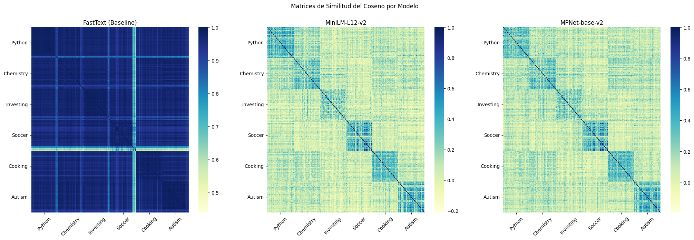

# Reddit NLP Analysis

**From subreddit classification to semantic search and generative NLP**

Python · scikit-learn · fastText · Transformers · PyTorch · Sentence Transformers

**Enrique Vicente Pujante & José Montesinos Pineda**  
Procesamiento del Lenguaje Natural Escrito · Universidad de Murcia

> Preservation: only two embedded authentication tokens were replaced with reads from the `HF_TOKEN` environment variable in the public notebook. All other code, Markdown, saved outputs and metadata are unchanged.

## Overview

A notebook-based academic exploration of Reddit text: corpus extraction, subreddit classification, semantic thread similarity, abstractive summarisation and prompted detection of inappropriate content.

The main corpus covers **r/Autism, r/Chemistry, r/Cooking, r/Investing, r/Python and r/Soccer**, with 40 threads per community. A separate r/OpinionesPolemicas dataset is used for Spanish-language moderation experiments.

All original implementation and analysis live in one notebook, [PLNE_EnriqueVicente_JoseMontesinos_Final.ipynb](PLNE_EnriqueVicente_JoseMontesinos_Final.ipynb). This project is presented as an academic record with documented limitations, rather than a production moderation system or a validated benchmark.

## What was explored

| Area | Approaches | Status in the submitted notebook |
| --- | --- | --- |
| Corpus construction | Streaming `.zst` files; text, metadata and temporal selection filters | Implemented |
| Comment classification | BoW/TF-IDF + LinearSVC; fastText + LinearSVC/RandomForest; mBERT fine-tuning | Implemented, with evaluation caveats |
| Thread similarity | fastText, multilingual MiniLM and MPNet; cosine similarity; PCA/t-SNE | Implemented |
| Subjectivity/sentiment | Planned assignment section | Not implemented |
| Summarisation | mT5 XLSum, Llama 3.2 1B Instruct and Gemma 3 1B | Implemented, qualitative comparison |
| Inappropriate-content detection | Gemma 3 1B with zero-shot, few-shot and rationale-based prompts | Implemented, exploratory outputs |

## A visual example

The figure below is extracted directly from the notebook's saved outputs; it has not been recomputed or edited.

The saved fastText similarities are concentrated near the high end of their scale, whereas the sentence-transformer plots show more differentiated blocks. **Colour scales differ between panels.** This is a qualitative observation, not a retrieval-quality benchmark. See [the original embedding projections](assets/embedding-projections.png) and [evaluation notes](docs/EVALUATION.md).

## Recorded classification results

Values below are transcribed from saved notebook outputs, not from a new training run.

| Model | Recorded accuracy |
| --- | ---: |
| BoW + LinearSVC | 72.73% |
| TF-IDF + LinearSVC | 77.27% |
| fastText + LinearSVC | 81.22% |
| fastText + RandomForest | 76.97% |

The notebook also reports mBERT accuracy **85.11%** and macro-F1 **0.8503**, but its test split is reused for epoch evaluation and best-checkpoint selection. That result is **not an independent held-out test score** and is not ranked against the baselines here. The n-gram comparison also explores multiple configurations on the same test set.

The implementation loads `bert-base-multilingual-cased`; the notebook's summary-table label “mDeBerta” is inconsistent with the code. The original label is preserved in the notebook; this companion documentation uses the actual model identifier.

## Data and reproducibility

- Saved split: **3,692 training comments / 1,672 test comments**.
- No shared submission IDs or comment IDs were found between the supplied train/test files.
- The six filtered JSON files contain **5,350 comments**, while the split files contain **5,364**. Their provenance should be reconciled before a fresh experiment.
- The source archive does not include the large Reddit `.zst` dumps or the fastText model binary.
- The notebook uses Google Drive paths and GPU-dependent model-loading code. It was not rerun during this preparation.

See [data inventory](docs/DATA.md) and [reproduction notes](docs/REPRODUCIBILITY.md). Bulk Reddit JSON files are not redistributed in this repository; they contain user text, usernames and identifiers, and are not covered by the project's MIT licence.

## Improvements identified

The main next step is a thread-separated **train/development/test** evaluation, using development data for model/configuration selection. Other improvements include consistent macro-F1 reporting, richer corpus statistics, error analysis, explicit handling of long threads, and a labelled evaluation set for moderation. These are documented as future work; no original experiments have been rewritten.

## Authors

**Enrique Vicente Pujante** and **José Montesinos Pineda**. The notebook explicitly identifies both authors. No unsupported division of individual contributions is inferred.

[Enrique's GitHub](https://github.com/evicentep) · [Enrique's LinkedIn](https://www.linkedin.com/in/enrique-vicente-pujante/)

## Licence

See [LICENSE](LICENSE) for the MIT licence covering original project code and documentation. Reddit posts/comments, external model weights, dependencies and course materials retain their own terms. The instructor's correction and assignment PDF are not included in the public package.
